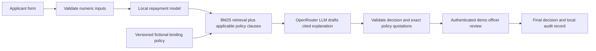

# Team 12 build plan

## What we are building

A classroom system for a fictional retail bank that accepts synthetic financial details, produces a model recommendation, explains it with cited bank policy, and waits for a human loan officer to record the decision. Section C - Team 12 owns the policy and the demonstration. The app is not a real lending service.

## What RAG retrieves

Yes, write a fictional lending policy for this assignment. No confidential bank documents are required. `policy.json` is the canonical policy created for this project. `lending_policy.md` is its human-readable copy. Ten numbered clauses cover product scope, income, credit score, debt service, late payments, product limits, model uncertainty, human authority, customer explanations and privacy.

Each clause's title and text is one searchable chunk. The retrieval index uses BM25, a lexical search algorithm. It computes document-frequency-weighted relevance to a query made from the applicant facts and review flags. It is real document retrieval without a paid embeddings service. A vector database is not a requirement for RAG, and adds little value to a ten-clause document. BM25 can miss paraphrases; exact numeric policy matches and review obligations are therefore added to the retrieved evidence.

The numeric policy checks read structured conditions from the same policy file. These checks are deterministic business rules, separate from the model and the language generator. They ensure a rule such as debt service above 40% is not guessed by an LLM.

## End-to-end flow

If the provider is not connected or the generated response fails checks, no LLM explanation is shown. The model result and retrieved policy evidence remain available for human review. An unsupported self-employed application cannot be approved under this policy.

## Implementation stages and acceptance criteria

| Stage | Implementation | Acceptance criterion | Status |
|---|---|---|---|
| Policy | One canonical versioned source and readable document | Rules and retrieved text come from the same policy | Built |
| Predictive model | Logistic regression on simulated repayment outcomes | Separate training, validation and test sets; baseline and confusion matrix | Built and evaluated |
| RAG | BM25 search, exact rule evidence, OpenRouter prompt | Returned quotes match retrieved clauses; no unknown citations or changed recommendation | Built; contract tests pass |
| Interface | Form, policy library, evidence trail, model evaluation | Approval, rejection and scope-gap demo cases usable in browser | Built and browser checked |
| Human checkpoint | Officer passcode, review queue, reason, exception acknowledgement | Visitor cannot finalize; unsupported scope cannot be approved; decision audited | Built and HTTP tested |
| LLM evaluation | 30-case collector and manual rubric | Actual responses graded for factuality, policy interpretation and hallucination | Harness built; live key and human ratings still needed |
| Deployment | Standard-library Python server, container recipe | Public HTTPS URL with persistent storage and platform secrets | Prepared; not publicly deployed |
| Final demonstration | Script, risk discussion, cost assumptions, prompt log | 10–12 minute presentation using three real app cases | Written plan supplied; team rehearsal remains |

## Predictive model and evaluation

The dataset has 2,400 synthetic salaried applicants. The generator uses a seeded probabilistic formula based on financial features to simulate full repayment, then samples binary outcomes. It includes uncertainty: two similar applicants can have different simulated outcomes.

Split: 1,440 training, 480 validation and 480 test records, with a fixed shuffle seed. A logistic regression is trained from scratch with gradient descent. Five predictors are credit score, total debt-service ratio including the proposed payment, loan-to-income ratio, late payments and employment years. The majority-class baseline always rejects. The validation set selects a threshold using assumed costs of 5 units for a false approval and 1 for a missed approval. These units express a relative classroom trade-off, not bank cost estimates.

The model artifact contains the measured results. The app shows both the chosen threshold and a fixed 0.50 reference. The chosen threshold is conservative and misses many simulated repayers. All data and labels are synthetic, and the generator uses the same predictors as the model. This does not establish external validity, calibrated real-world probabilities or demographic fairness.

## Explanation design

The LLM receives the applicant fields, calculated affordability, model recommendation, main feature associations, policy flags and retrieved clause text. Its JSON response includes the recommendation, summary, human-review requirement and per-clause quoted evidence. Validation rejects a changed decision, missing required clause, invented quotation, unknown source or malformed response. Semantic errors can still pass these checks and must be caught by the reviewer and the evaluation rubric.

The default is `openrouter/free`. It selects from available free models; the actual served model is recorded with each case. For a consistent evaluation, set `OPENROUTER_MODEL` to a specific model currently available in your account. There is no automatic paid fallback. A key is required even for free inference. No live key was available during this build, so no live LLM accuracy is claimed.

## Risks and ownership

- Member A: data generation, model metrics, threshold and error-cost analysis.
- Member B: policy, retrieval relevance and human grading of explanation drafts.
- Member C: injection tests, source-validation failures, access and privacy checks.
- Member D: UI, public hosting, final demo, presentation and operations.

Bias: financial variables may proxy protected traits. Absence of those traits is not a fairness proof. Before actual deployment, use representative, consented data and qualified reviewers to define appropriate group metrics and controls.

Privacy: use only synthetic cases. Values are stored in local SQLite for the demonstration. Hosted LLM providers may retain requests according to their policies. Keys remain server-side; they are never written to the source or displayed in the browser. Production authentication, retention/deletion controls, encryption, qualified regulatory review and operational security are beyond this classroom build.

Misuse and transparency: do not use the app to make real lending decisions. Label the educational scope, display exact policy evidence, separate model recommendations from human decisions, and permit corrected inputs to be assessed as a new case.

## Immediate team work

1. Launch with a key and run the three examples with LLM generation enabled.
2. Run the 30-case evaluation, then have two members rate the responses independently and resolve disagreements.
3. Pin the model used for the final test, record failures and measure response time.
4. Deploy to the team's hosting account, configure HTTPS and a persistent data volume, and keep all demo inputs synthetic.
5. Replace Member A–D labels with names and rehearse the script before Session 10.
